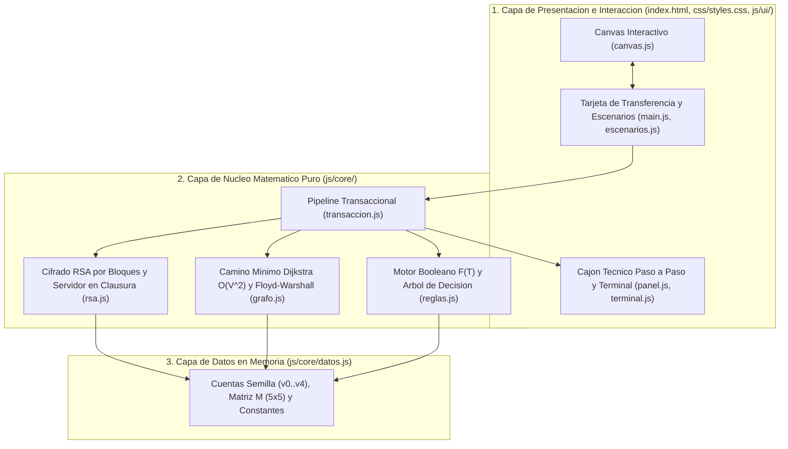

# 6.3. Marco Tecnológico

> **Nota para exportación a Microsoft Word:** para convertir este apartado a formato `.docx`, ejecuta en la terminal:
> ```bash
> pandoc docs/6.3_marco_tecnologico.md -o docs/6.3_marco_tecnologico.docx
> ```

Para construir, verificar y documentar el simulador **PayGraph**, seleccionamos un conjunto de tecnologías web estándar que permiten abrir la aplicación directamente desde el sistema de archivos local (`file://`) mediante doble clic sobre `index.html`, sin requerir servidores web ni gestores de paquetes en el navegador. En la siguiente tabla registramos únicamente las tecnologías y herramientas que empleamos de manera efectiva durante esta implementación.

## 1. Matriz de Tecnologías Implementadas

| Tecnología / Herramienta | Versión | Para qué la usamos en el proyecto | Módulo o archivo donde interviene |
|---|---|---|---|
| **HTML5 Semántico + WAI-ARIA** | Living Standard | Estructuramos la interfaz en una sola pantalla con divulgación progresiva, atributos de accesibilidad (`aria-live="polite"`, `role="tablist"`, `role="alert"`) y navegación completa por teclado. | `index.html`, `js/ui/panel.js`, `js/ui/terminal.js`, `js/ui/main.js` |
| **CSS3 (Custom Properties / Tokens)** | Nivel 3 | Definimos las variables del sistema de diseño (paleta semántica para modo claro y oscuro, tipografía tabular, grilla base de 8 px, objetivos táctiles $\ge 44\text{ px}$ y respeto a `prefers-reduced-motion`). | `css/styles.css`, `design/design-tokens.json` |
| **Tailwind CSS (Play CDN)** | `3.4.17` (fija) | Aplicamos utilidades de maquetación responsiva (de `360px` a `1440px`), grillas adaptativas y espaciado consistente sin pasos de compilación ni *bundlers*. | `index.html` (`https://cdn.tailwindcss.com/3.4.17`) |
| **Lucide Icons (UMD CDN con SRI)** | `0.469.0` (fija) | Incorporamos el soporte iconográfico ligero con verificación criptográfica de integridad de subrecursos (`sha384`) y respaldo textual/Unicode para apertura sin conexión. | `index.html`, `js/ui/main.js` (`https://unpkg.com/lucide@0.469.0/dist/umd/lucide.min.js`) |
| **JavaScript (ES6+ y `BigInt`)** | ECMAScript 2020+ | Implementamos en módulos puros con patrón UMD clásico (`window.PayGraph` y `module.exports`) la potenciación modular rápida con `BigInt` (Stallings, 2017), el algoritmo de Dijkstra $O(|V|^2)$ (Cormen et al., 2009), la regla booleana $F(T)$ (Rosen, 2019), el Árbol de Decisión y el formateo monetario `Intl.NumberFormat('es-CO')`. | `js/core/datos.js`, `js/core/rsa.js`, `js/core/grafo.js`, `js/core/reglas.js`, `js/core/transaccion.js`, `js/ui/*.js` |
| **HTML5 Canvas 2D API** | Estándar W3C / WHATWG | Renderizamos el grafo ponderado $G=(V,E)$ con escalado nítido `window.devicePixelRatio`, selección de nodos por clic y teclado, visualización de comisiones, animación progresiva de la ruta óptima con `requestAnimationFrame`, pulso de aprobación y vibración de rechazo. | `index.html`, `js/ui/canvas.js` |
| **Web Performance API (`performance.now`)** | High Resolution Time | Medimos en milisegundos con precisión de sub-milisegundo el tiempo real de cálculo y actualización de cada transferencia para comprobar el cumplimiento del requerimiento RNF-01 ($< 100\text{ ms}$). | `js/core/transaccion.js`, `js/ui/main.js` |
| **Node.js + `node:assert/strict`** | `v22.x` (nativo) | Ejecutamos desde consola la suite automatizada de 24 pruebas (`node tests/run.js`) sin dependencias externas, validando los vectores RSA, los 10.000 PIN por bloques, la coincidencia Dijkstra vs. Floyd–Warshall, los 4 escenarios didácticos y el invariante de conservación monetaria. | `tests/run.js`, `js/core/*.js` |
| **Google Antigravity + Skills Integradas** | Entorno Agéntico IDE | Orquestamos el desarrollo por fases aplicando las skills `clean-code` (funciones puras, modularidad y docstrings con fórmulas), `pentest-checklist` (validación de entradas en borde, clausura para $d$, cero `innerHTML`/`eval`) y las skills de Figma/UI-UX (`figma-create-new-file`, `figma-generate-diagram`, `figma-design-to-code`, `figma-generate-library`, `figma-generate-design`, `figma-use`, `figma-implement-motion`). | Todo el repositorio (`design/`, `js/`, `css/`, `tests/`, `docs/`) |
| **Servidor MCP de Figma (`figma_figma`)** | Integración MCP | Verificamos la cuenta autenticada con `whoami`, creamos el archivo base de diseño en Figma (`create_new_file`, clave `mYZSybymT6PRKU89OrV29D`) y generamos en FigJam el diagrama editable del pipeline matemático y del Árbol de Decisión (`generate_diagram`, clave `WQc2fIoUkVdml2QEpCxQDC`). Dado que el servidor MCP instalado no expone la herramienta `use_figma` y la cuenta cuenta con asiento `View` en el plan *Starter*, documentamos y aplicamos los tokens directamente en `design/design-tokens.json` y `css/styles.css`. | `design/DESIGN.md`, `design/design-tokens.json` |
| **Google Chrome Headless (CDP)** | `v130+` (local) | Verificamos la apertura real de `index.html` por protocolo `file://`, comprobamos cero errores en consola y generamos las capturas de evidencia en `360px` y `1280px` (modo claro y oscuro) y de los 4 escenarios didácticos. | `design/capturas/*.png` |

---

## 2. Arquitectura en Tres Capas

Implementamos una arquitectura desacoplada en tres capas que separa estrictamente el modelo matemático de la interfaz gráfica:



---

## 3. Límites Tecnológicos Asumidos

De acuerdo con el alcance académico del proyecto (sección 7.2 de la guía docente), asumimos y documentamos tres límites arquitectónicos:
1. **Sin servidor backend ni base de datos persistente:** toda la simulación se ejecuta en la memoria RAM del navegador (`js/core/transaccion.js`). No usamos `localStorage`, cookies ni motores SQL/NoSQL; al recargar la página o pulsar «Reiniciar simulación», los saldos regresan a sus valores semilla iniciales y las comisiones acumuladas vuelven a $\$0\text{ COP}$.
2. **Criptografía RSA didáctica y servidor simulado local:** utilizamos primos pequeños ($p=61, q=53, n=3233$) y un esquema determinista por bloques de 2 dígitos para que el estudiante pueda verificar cada paso aritmético. Aunque aislamos la clave privada $d=2753$ dentro de una clausura de JavaScript (`crearServidorSimulado`), en un entorno bancario de producción el descifrado jamás ocurriría en el cliente sino en un servidor remoto protegido por TLS y módulos criptográficos de hardware (HSM) con llaves de al menos $2048$ bits (Stallings, 2017).
3. **Dependencia de CDN para utilidades visuales:** la hoja de utilidades de Tailwind CSS (`3.4.17`) y el paquete de iconos Lucide (`0.469.0`) se cargan desde sus CDN con versión fija al abrir `index.html`. Por ello, la primera carga requiere conexión a internet para obtener la caché del CDN, si bien toda la lógica matemática, el lienzo Canvas y las variables CSS de `css/styles.css` funcionan íntegramente de forma local.

## Referencias Bibliográficas Citadas

1. Cormen, T. H., Leiserson, C. E., Rivest, R. L., & Stein, C. (2009). *Introduction to Algorithms* (3rd ed.). MIT Press.
2. Rosen, K. H. (2019). *Discrete Mathematics and Its Applications* (8th ed.). McGraw-Hill.
3. Stallings, W. (2017). *Cryptography and Network Security: Principles and Practice* (7th ed.). Pearson.
