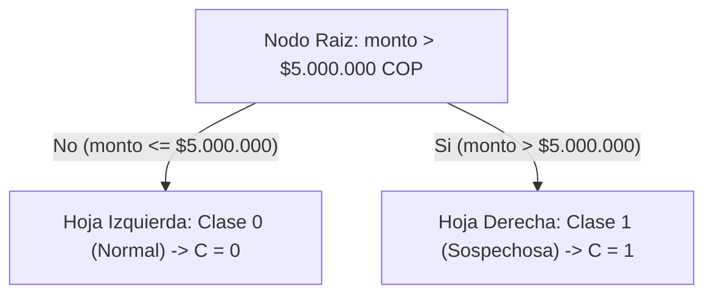

# Modelo Matemático Completo y Verificado — PayGraph

> **Nota para exportación a Microsoft Word:** este documento utiliza Markdown con ecuaciones en notación LaTeX (`$...$` y `$$...$$`). Para convertirlo directamente a un archivo `.docx` con ecuaciones nativas de Word (OMML), ejecuta en una terminal donde esté instalado Pandoc:
> ```bash
> pandoc docs/modelo_matematico.md -o docs/modelo_matematico.docx
> ```

---

## 1. Notación General y Supuestos del Dominio

En PayGraph modelamos una red interbancaria de pagos digitales mediante cuatro estructuras discretas acopladas:

| Símbolo | Dominio / Definición | Significado en el Sistema |
|---|---|---|
| $V = \{v_0, v_1, v_2, v_3, v_4\}$ | Conjunto finito de $|V| = 5$ vértices | Cuentas seleccionables (usuarios y bancos) |
| $E \subseteq V \times V$ | Conjunto de arcos dirigidos | Canales de transferencia directa entre entidades |
| $M \in (\mathbb{Z}_{\ge 0} \cup \{\infty\})^{5 \times 5}$ | Matriz de adyacencia ponderada | Costo directo de comisión interbancaria en COP |
| $D \in \mathbb{Z}_{\ge 0}^{5 \times 5}$ | Matriz de costos mínimos | Comisión óptima $D[i][j]$ calculada con Dijkstra |
| $(n, e) = (3233, 17)$ | Par de enteros positivos | Clave pública RSA en el módulo cliente (`rsa.js`) |
| $d = 2753$ | Entero positivo en $\mathbb{Z}_{\varphi(n)}$ | Clave privada RSA encapsulada en el servidor simulado |
| $\text{PIN} = d_1 d_2 d_3 d_4 \in \{0,\dots,9\}^4$ | Cadena de 4 dígitos decimales | Clave secreta de autenticación de cada cuenta |
| $[m_1, m_2] \in \{0,\dots,99\}^2$ | Par de bloques enteros de 2 dígitos | Partición biyectiva del PIN ($m_i < n = 3233$) |
| $[c_1, c_2] \in \{0,\dots,3232\}^2$ | Token cifrado de dos bloques | Criptograma transmitido al servidor simulado |
| $T = (v_o, v_d, \text{monto}, \text{PIN})$ | Tupla de transacción | Solicitud de transferencia desde $v_o$ hacia $v_d$ |
| $A, B, C \in \{0, 1\}$ | Variables proposicionales booleanas | Suficiencia de saldo ($A$), validez de PIN ($B$) y alerta IA ($C$) |
| $F(T) = A \land B \land (\neg C)$ | Fórmula proposicional compuesta | Regla determinista de autorización de la transferencia |

### Datos Semilla Declarados (`js/core/datos.js`)
Los saldos iniciales y los códigos PIN de las cinco cuentas constituyen supuestos académicos editables en `js/core/datos.js`, empleando nombres ficticios sin marcas comerciales reales:

| Vértice | Nombre | Rol | Saldo Inicial (COP) | PIN Semilla | Token RSA $[c_1, c_2]$ |
|---|---|---|---:|---|---|
| $v_0$ | Usuario A | Usuario | $\$8.000.000$ | `"1234"` | `[1730, 180]` |
| $v_1$ | Banco Alfa | Banco | $\$40.000.000$ | `"2468"` | `[1639, 1759]` |
| $v_2$ | Usuario B | Usuario | $\$3.500.000$ | `"1357"` | `[47, 1175]` |
| $v_3$ | Banco Beta | Banco | $\$25.000.000$ | `"9753"` | `[1632, 1802]` |
| $v_4$ | Usuario C | Usuario | $\$2.000.000$ | `"4096"` | `[642, 494]` |

La masa monetaria inicial del sistema es:

$$
M_0 = \sum_{i=0}^{4} \text{saldo}_0(v_i) = 8.000.000 + 40.000.000 + 3.500.000 + 25.000.000 + 2.000.000 = \$78.500.000\text{ COP}
$$

---

## 2. Aritmética Modular y Criptografía RSA por Bloques

### 2.1 Construcción de Parámetros y Función $\varphi$ de Euler
Partimos de los dos números primos distintos fijados en la guía docente (Stallings, 2017; Rosen, 2019):

$$
p = 61, \qquad q = 53
$$

Calculamos el módulo público $n$ y la función indicatriz de Euler $\varphi(n)$:

$$
n = p \cdot q = 61 \times 53 = 3233
$$

$$
\varphi(n) = (p - 1)(q - 1) = 60 \times 52 = 3120
$$

Seleccionamos el exponente público $e = 17$. Como $17$ es primo y $3120 = 17 \times 183 + 9$, se cumple que $\gcd(17, 3120) = 1$, por lo que existe un único inverso multiplicativo modular $d \in \{1, \dots, 3119\}$ tal que:

$$
e \cdot d \equiv 1 \pmod{\varphi(n)} \iff 17 \cdot d \equiv 1 \pmod{3120}
$$

### 2.2 Derivación de $d = 2753$ mediante el Algoritmo de Euclides Extendido
Implementamos en `Rsa.euclidesExtendido(17, 3120)` las divisiones sucesivas $r_{k-1} = q_k \cdot r_k + r_{k+1}$ y la recurrencia de coeficientes de Bézout $s_{k+1} = s_{k-1} - q_k s_k$, $t_{k+1} = t_{k-1} - q_k t_k$ tales que $17 s_k + 3120 t_k = r_k$:

| Paso $k$ | Dividendo $r_{k-1}$ | Divisor $r_k$ | Cociente $q_k$ | Residuo $r_{k+1}$ | Coeficiente $s_{k+1}$ | Coeficiente $t_{k+1}$ | Identidad de Bézout Parcial |
|---:|---:|---:|---:|---:|---:|---:|---|
| Inicial | $3120$ | $17$ | — | — | $s_0=1,\; s_1=0$ | $t_0=0,\; t_1=1$ | — |
| 1 | $17$ | $3120$ | $0$ | $17$ | $1$ | $0$ | $17(1) + 3120(0) = 17$ |
| 2 | $3120$ | $17$ | $183$ | $9$ | $-183$ | $1$ | $17(-183) + 3120(1) = 9$ |
| 3 | $17$ | $9$ | $1$ | $8$ | $184$ | $-1$ | $17(184) + 3120(-1) = 8$ |
| 4 | $9$ | $8$ | $1$ | $1$ | $-367$ | $2$ | $17(-367) + 3120(2) = 1$ |
| 5 | $8$ | $1$ | $8$ | $0$ | $3120$ | $-17$ | Fin ($\gcd(17, 3120) = 1$) |

De la cuarta iteración obtenemos la identidad de Bézout:

$$
17 \cdot (-367) + 3120 \cdot 2 = 1 \implies 17 \cdot (-367) \equiv 1 \pmod{3120}
$$

Reduciendo el coeficiente $x = -367$ al representante canónico positivo en $\mathbb{Z}_{3120}$:

$$
d = (-367) \bmod 3120 = 3120 - 367 = 2753
$$

**Comprobación directa:**

$$
17 \times 2753 = 46801 = 15 \times 3120 + 1 \equiv 1 \pmod{3120}
$$

### 2.3 Potenciación Modular Rápida ($17 = 10001_2$) y Ejemplo Completo con PIN `"1234"`
Para evaluar $c = m^e \bmod n$ y $m = c^d \bmod n$ sin desbordamiento aritmético, implementamos en `Rsa.modPow(base, exponente, modulo)` el método de cuadrados sucesivos sobre enteros de precisión arbitraria (`BigInt`), cuya complejidad es $O(\log_2 e)$ multiplicaciones modulares (Cormen et al., 2009).

En binario, el exponente público es $e = 17 = (10001)_2 = 2^4 + 2^0$. Al cifrar el PIN `"1234"`, el módulo cliente lo divide en dos bloques de 2 dígitos: $m_1 = 12$ y $m_2 = 34$.

#### Traza de cuadrados sucesivos para el Bloque 1 ($m_1 = 12$, $c_1 = 12^{17} \bmod 3233$)
| Iteración $k$ | Exponente restante | Bit $e_k$ | Base modular $b_k \bmod 3233$ | Acumulador previo | ¿Multiplica? ($e_k=1$) | Acumulador nuevo $\bmod 3233$ | Siguiente base $b_k^2 \bmod 3233$ |
|---:|---:|---:|---:|---:|:---:|---:|---:|
| 0 | $17$ | $1$ | $12$ | $1$ | Sí | $(1 \times 12) \bmod 3233 = 12$ | $12^2 \bmod 3233 = 144$ |
| 1 | $8$ | $0$ | $144$ | $12$ | No | $12$ | $144^2 \bmod 3233 = 1338$ |
| 2 | $4$ | $0$ | $1338$ | $12$ | No | $12$ | $1338^2 \bmod 3233 = 2163$ |
| 3 | $2$ | $0$ | $2163$ | $12$ | No | $12$ | $2163^2 \bmod 3233 = 1919$ |
| 4 | $1$ | $1$ | $1919$ | $12$ | Sí | $(12 \times 1919) \bmod 3233 = \mathbf{1730}$ | $1919^2 \bmod 3233 = 97$ |

#### Traza de cuadrados sucesivos para el Bloque 2 ($m_2 = 34$, $c_2 = 34^{17} \bmod 3233$)
| Iteración $k$ | Exponente restante | Bit $e_k$ | Base modular $b_k \bmod 3233$ | Acumulador previo | ¿Multiplica? ($e_k=1$) | Acumulador nuevo $\bmod 3233$ | Siguiente base $b_k^2 \bmod 3233$ |
|---:|---:|---:|---:|---:|:---:|---:|---:|
| 0 | $17$ | $1$ | $34$ | $1$ | Sí | $(1 \times 34) \bmod 3233 = 34$ | $34^2 \bmod 3233 = 1156$ |
| 1 | $8$ | $0$ | $1156$ | $34$ | No | $34$ | $1156^2 \bmod 3233 = 1140$ |
| 2 | $4$ | $0$ | $1140$ | $34$ | No | $34$ | $1140^2 \bmod 3233 = 2937$ |
| 3 | $2$ | $0$ | $2937$ | $34$ | No | $34$ | $2937^2 \bmod 3233 = 955$ |
| 4 | $1$ | $1$ | $955$ | $34$ | Sí | $(34 \times 955) \bmod 3233 = \mathbf{180}$ | $955^2 \bmod 3233 = 3067$ |

El token cifrado transmitido es `[1730, 180]`. En el servidor simulado, al aplicar el exponente privado $d = 2753$:

$$
m_1 = 1730^{2753} \bmod 3233 = 12, \qquad m_2 = 180^{2753} \bmod 3233 = 34 \implies \text{PIN} = \text{"12"} \mathbin{\Vert} \text{"34"} = \text{"1234"}
$$

### 2.4 Justificación de la Correctitud (Teoremas de Euler y Pequeño de Fermat)
Como $e \cdot d = 1 + k \varphi(n) = 1 + k(p-1)(q-1)$ con $k = 15$, para cualquier bloque $m \in \{0, \dots, n-1\}$:
1. Si $\gcd(m, p) = 1$, por el Pequeño Teorema de Fermat $m^{p-1} \equiv 1 \pmod p$, de donde:
   $$
   m^{ed} = m \cdot \left(m^{p-1}\right)^{k(q-1)} \equiv m \cdot 1^{k(q-1)} \equiv m \pmod p
   $$
   Si $p \mid m$, entonces $m \equiv 0 \pmod p$ y trivialmente $m^{ed} \equiv 0 \equiv m \pmod p$.
2. Por simetría, $m^{ed} \equiv m \pmod q$ para todo entero $m$.
3. Como $p = 61$ y $q = 53$ son primos distintos ($\gcd(p, q) = 1$), por el Teorema Chino del Residuo concluimos que para todo $m \in \{0, \dots, n-1\}$:

$$
c^d \equiv (m^e)^d = m^{ed} \equiv m \pmod{3233}
$$

### 2.5 Corrección Matemática a la Guía: Por qué usamos 2 Bloques de 2 Dígitos
El Teorema de Euler–Fermat garantiza recuperar $m \bmod n$. Para que la función de cifrado sea inyectiva sobre el espacio de mensajes, es indispensable que todo mensaje cumpla $0 \le m < n = 3233$.
- Si cifráramos un PIN de 4 dígitos ($0000$ a $9999$) como un único entero $m$, cualquier PIN con $m \ge 3233$ sufriría reducción modular previa y **colisionaría** con $m \bmod 3233$:
  - **Contraejemplo 1 (`PIN = 3300`):** $3300 \equiv 67 \pmod{3233}$. Se cifra como $c = 3300^{17} \bmod 3233 = 2059$, y al descifrar entrega $2059^{2753} \bmod 3233 = \mathbf{67} \neq 3300$.
  - **Contraejemplo 2 (`PIN = 4000`):** $4000 \equiv 767 \pmod{3233}$. Se cifra como $c = 4000^{17} \bmod 3233 = 1353$, y al descifrar entrega $1353^{2753} \bmod 3233 = \mathbf{767} \neq 4000$.
- **Solución implementada:** tratamos el PIN como una cadena de 4 caracteres y lo particionamos en dos bloques de 2 dígitos $[m_1, m_2] \in \{0, \dots, 99\}^2$. Dado que $\max(m_i) = 99 < 3233$, la biyección se cumple sin excepciones para los $10.000$ PIN de `"0000"` a `"9999"`, formateando cada bloque descifrado con relleno de dos dígitos (`padStart(2, '0')`) para preservar los ceros a la izquierda.

### 2.6 Limitaciones Declaradas del Esquema Criptográfico
Por honestidad académica e ingeniería de seguridad declaramos cinco limitaciones inherentes a este modelo didáctico:
1. **RSA «de libro» (*textbook RSA*):** es determinista y carece de esquema de relleno probabilístico (como OAEP); bloques idénticos producen siempre el mismo criptograma (por ejemplo, `"1111"` $\to$ `[3061, 3061]`).
2. **Módulo $n = 3233$ factorizable al instante:** al tener solo 12 bits ($\approx \log_2 3233 = 11.66$), se factoriza por división tentativa en microsegundos, mientras que en producción se exigen claves de al menos $2048$ bits.
3. **Espacio de claves reducido:** existen únicamente $10^4 = 10.000$ combinaciones de PIN posibles y $100$ valores posibles por bloque ($00$ a $99$), vulnerables a un diccionario precalculado.
4. **Existencia de 25 puntos fijos:** en $\mathbb{Z}_{3233}$ existen exactamente $(1 + \gcd(e-1, p-1))(1 + \gcd(e-1, q-1)) = (1 + \gcd(16, 60))(1 + \gcd(16, 52)) = (1+4)(1+4) = \mathbf{25}$ mensajes que cumplen $m^{17} \equiv m \pmod{3233}$, incluidos $m = 0$ y $m = 1$ (y en el rango $[0, 99]$ también $m = 61$).
5. **Ejecución local en navegador:** aunque encapsulamos la clave privada $d = 2753$ dentro de una clausura privada en `Rsa.crearServidorSimulado`, en un sistema financiero real la clave privada jamás residiría en el navegador del cliente sino en un servidor backend o módulo de seguridad de hardware (HSM).

---

## 3. Teoría de Grafos y Optimización de Rutas (Dijkstra)

### 3.1 Definición Formal y Simetría de la Matriz $M$
Definimos la red interbancaria como un grafo dirigido ponderado $G = (V, E, w)$ con conjunto de vértices $V = \{v_0, v_1, v_2, v_3, v_4\}$ y matriz de adyacencia $M$ de dimensión $5 \times 5$:

$$
M = \begin{pmatrix}
0 & 300 & 800 & \infty & 1200 \\
300 & 0 & 200 & 400 & 500 \\
800 & 200 & 0 & 300 & \infty \\
\infty & 400 & 300 & 0 & 600 \\
1200 & 500 & \infty & 600 & 0
\end{pmatrix}
$$

**Propiedades estructurales verificadas en `Grafo.esMatrizSimetrica(M)`:**
- **Diagonal nula:** $M[i][i] = 0$ para todo $i \in \{0, \dots, 4\}$.
- **Pesos estrictamente positivos fuera de la diagonal:** $w(u, v) \in \{200, 300, 400, 500, 600, 800, 1200\}$ COP (requisito de no negatividad para la optimalidad de Dijkstra).
- **Simetría ($M = M^\top$):** para todo par $(u, v)$ se cumple $M[u][v] = M[v][u]$. Es decir, cada canal interbancario está modelado como un par de arcos dirigidos opuestos con el mismo peso, lo cual es matemáticamente equivalente a un grafo no dirigido ponderado con $|E_{\text{dir}}| = 14$ arcos dirigidos ($7$ canales bidireccionales).

### 3.2 Traza Paso a Paso de Dijkstra desde $v_0$
Ejecutando `Grafo.dijkstra(M, 0, 4)` para hallar los caminos mínimos desde $v_0$ (Usuario A), registramos el vector de distancias tentativas $\text{dist}[v]$ y predecesores $\text{prev}[v]$ tras fijar cada vértice $u$:

| Iteración | Vértice fijado $u$ | Conjunto visitado $S$ | $\text{dist}[v_0]$ | $\text{dist}[v_1]$ | $\text{dist}[v_2]$ | $\text{dist}[v_3]$ | $\text{dist}[v_4]$ | Relajaciones efectivas ($\text{dist}[v] \leftarrow \text{dist}[u] + M[u][v]$) |
|---:|:---:|---|---:|---:|---:|---:|---:|---|
| 0 (Inicio) | — | $\emptyset$ | $0$ | $\infty$ | $\infty$ | $\infty$ | $\infty$ | Inicialización $\text{dist}[v_0] = 0$ |
| 1 | $v_0$ | $\{v_0\}$ | $\mathbf{0}$ | $300$ | $800$ | $\infty$ | $1200$ | $v_1 \leftarrow 300\;(v_0)$,\; $v_2 \leftarrow 800\;(v_0)$,\; $v_4 \leftarrow 1200\;(v_0)$ |
| 2 | $v_1$ | $\{v_0, v_1\}$ | $0$ | $\mathbf{300}$ | $500$ | $700$ | $800$ | $v_2 \leftarrow 300+200=\mathbf{500}\;(v_1)$,\; $v_3 \leftarrow 300+400=\mathbf{700}\;(v_1)$,\; $v_4 \leftarrow 300+500=\mathbf{800}\;(v_1)$ |
| 3 | $v_2$ | $\{v_0, v_1, v_2\}$ | $0$ | $300$ | $\mathbf{500}$ | $700$ | $800$ | $v_3:\; 500+300=800 \not< 700$ (sin cambios) |
| 4 | $v_3$ | $\{v_0, v_1, v_2, v_3\}$ | $0$ | $300$ | $500$ | $\mathbf{700}$ | $800$ | $v_4:\; 700+600=1300 \not< 800$ (sin cambios) |
| 5 | $v_4$ | $\{v_0, v_1, v_2, v_3, v_4\}$ | $0$ | $300$ | $500$ | $700$ | $\mathbf{800}$ | Todos los vecinos visitados (sin cambios) |

**Rutas óptimas desde $v_0$ (donde el enlace directo no es el más económico):**
- $v_0 \to v_2$: camino óptimo $v_0 \to v_1 \to v_2$ con costo $300 + 200 = \$500$ COP (ahorra $\$300$ frente al arco directo de $\$800$).
- $v_0 \to v_3$: camino óptimo $v_0 \to v_1 \to v_3$ con costo $300 + 400 = \$700$ COP (no existe arco directo, $M[0][3] = \infty$).
- $v_0 \to v_4$: camino óptimo $v_0 \to v_1 \to v_4$ con costo $300 + 500 = \$800$ COP (ahorra $\$400$ frente al arco directo de $\$1.200$).

### 3.3 Matriz Completa de Costos Mínimos $D$ y Complejidad Algorítmica
Al ejecutar Dijkstra desde cada vértice y contrastar con el algoritmo de Floyd–Warshall (`Grafo.floydWarshall(M)`), los $25$ pares $(v_i, v_j)$ coinciden exactamente en la matriz simétrica de costos mínimos $D$:

$$
D = \begin{pmatrix}
0 & 300 & 500 & 700 & 800 \\
300 & 0 & 200 & 400 & 500 \\
500 & 200 & 0 & 300 & 700 \\
700 & 400 & 300 & 0 & 600 \\
800 & 500 & 700 & 600 & 0
\end{pmatrix}
$$

**Complejidad temporal y espacial:** la versión matricial de Dijkstra explora en cada una de las $|V|$ iteraciones la búsqueda del mínimo no visitado en $O(|V|)$ y relaja los $|V|$ posibles vecinos de la fila $M[u]$ en $O(|V|)$, dando un tiempo total $T(|V|) = O(|V|^2)$ y espacio auxiliar $O(|V|)$ para los vectores `distancias`, `predecesores` y `visitados` (Cormen et al., 2009). Para $|V| = 5$, requiere únicamente $5^2 = 25$ inspecciones elementales por transferencia.

---

## 4. Lógica Proposicional y Desglose de Rechazo por De Morgan

### 4.1 Proposiciones Atómicas y Regla de Autorización $F(T)$
Sea $T = (v_o, v_d, \text{monto}, \text{PIN})$ una transacción con comisión mínima $W = D[v_o][v_d]$. Definimos las tres proposiciones atómicas:
- **$A$ (Suficiencia presupuestaria):**
  $$
  A \iff \big(\text{saldo}(v_o) \ge \text{monto} + W\big)
  $$
- **$B$ (Autenticación criptográfica RSA):**
  $$
  B \iff \big(\text{descifrar}_{d}([c_1, c_2]) = \text{PIN}_{\text{registrado}}(v_o)\big)
  $$
- **$C$ (Alerta del Árbol de Decisión):**
  $$
  C \iff \big(\text{monto} > \$5.000.000\text{ COP}\big)
  $$

La función booleana de aprobación es la conjunción:

$$
F(T) = A \land B \land (\neg C)
$$

### 4.2 Tabla de Verdad Completa ($2^3 = 8$ combinaciones)
| Fila | $A$ | $B$ | $C$ | $\neg C$ | $A \land B$ | $F(T) = A \land B \land \neg C$ | $\neg F(T) = \neg A \lor \neg B \lor C$ | Decisión del Sistema |
|---:|:---:|:---:|:---:|:---:|:---:|:---:|:---:|---|
| 1 | $0$ | $0$ | $0$ | $1$ | $0$ | $0$ | $1$ | Rechazada (fallan $A$ y $B$) |
| 2 | $0$ | $0$ | $1$ | $0$ | $0$ | $0$ | $1$ | Rechazada (fallan $A$, $B$ y alerta $C$) |
| 3 | $0$ | $1$ | $0$ | $1$ | $0$ | $0$ | $1$ | Rechazada (falla $A$: saldo insuficiente) |
| 4 | $0$ | $1$ | $1$ | $0$ | $0$ | $0$ | $1$ | Rechazada (falla $A$ y alerta $C$) |
| 5 | $1$ | $0$ | $0$ | $1$ | $0$ | $0$ | $1$ | Rechazada (falla $B$: PIN incorrecto) |
| 6 | $1$ | $0$ | $1$ | $0$ | $0$ | $0$ | $1$ | Rechazada (falla $B$ y alerta $C$) |
| 7 | **$1$** | **$1$** | **$0$** | **$1$** | **$1$** | **$1$** | **$0$** | **Aprobada (única combinación válida)** |
| 8 | $1$ | $1$ | $1$ | $0$ | $1$ | $0$ | $1$ | Rechazada (alerta de fraude $C=1$) |

### 4.3 Ley de De Morgan y Evaluación sin Cortocircuito
Aplicando las leyes de De Morgan y la doble negación sobre $F(T)$ (Rosen, 2019):

$$
\neg F(T) = \neg\big(A \land B \land (\neg C)\big) \equiv (\neg A) \lor (\neg B) \lor \neg(\neg C) \equiv (\neg A) \lor (\neg B) \lor C
$$

En `Reglas.evaluarAutorizacionSinCortocircuito`, calculamos siempre $A$, $B$ y $C$ antes de evaluar $F(T)$. Así, cuando $\neg F(T) = 1$, el sistema reporta **todas** las cláusulas activas de la disyunción $\neg A \lor \neg B \lor C$:
- Si $\neg A = 1$: `"Saldo insuficiente: necesitas $X (monto + comisión) y tienes $Y."`
- Si $\neg B = 1$: `"PIN incorrecto."`
- Si $C = 1$: `"Alerta de fraude (IA): monto superior a $5.000.000."`

---

## 5. Árbol de Decisión de un Umbral (Regla de Negocio)

El clasificador implementado en `Reglas.ARBOL_DECISION_FRAUDE` es un **árbol de decisión binario de profundidad 1 con un único umbral estricto definido por regla de negocio** ($\theta = \$5.000.000\text{ COP}$):

$$
h(\text{monto}) = \begin{cases}
1\;\text{(Sospechosa, } C = 1\text{)}, & \text{si } \text{monto} > 5.000.000 \\[4pt]
0\;\text{(Normal, } C = 0\text{)}, & \text{si } \text{monto} \le 5.000.000
\end{cases}
$$



**Alcance y evolución futura:** declaramos explícitamente que este árbol no proviene de un ajuste estadístico sobre datos históricos, sino de una partición determinista por umbral de negocio para ilustrar cómo la salida de un clasificador binario se acopla a una fórmula proposicional ($\neg C$). Su evolución hacia un árbol CART entrenado con múltiples variables (frecuencia, hora, grado del nodo) o una Red Neuronal de Grafos (*GNN*) queda planteada como trabajo futuro.

---

## 6. Integración, Invariante de Conservación y Análisis del RNF-01

### 6.1 Ecuaciones de Transición e Invariante de Conservación Monetaria
Sea $\text{saldo}_t(v)$ el saldo del nodo $v$ tras $t$ transferencias y $\text{Com}_t$ el acumulador de comisiones interbancarias ($\text{Com}_0 = 0$). Ante la transacción $t+1$ entre $v_o$ y $v_d$ con monto $K$ y comisión óptima $W = D[v_o][v_d]$:
- **Si $F(T) = 0$ (rechazada):** $\text{saldo}_{t+1}(v) = \text{saldo}_t(v)$ para todo $v \in V$, y $\text{Com}_{t+1} = \text{Com}_t$.
- **Si $F(T) = 1$ (aprobada):**
  $$
  \text{saldo}_{t+1}(v_o) = \text{saldo}_t(v_o) - (K + W), \qquad \text{saldo}_{t+1}(v_d) = \text{saldo}_t(v_d) + K, \qquad \text{Com}_{t+1} = \text{Com}_t + W
  $$

Sumando sobre todos los vértices y el acumulador de comisiones:

$$
\sum_{v \in V} \text{saldo}_{t+1}(v) + \text{Com}_{t+1} = \left(\sum_{v \in V} \text{saldo}_t(v) - (K + W) + K\right) + (\text{Com}_t + W) = \sum_{v \in V} \text{saldo}_t(v) + \text{Com}_t = M_0 = \$78.500.000\text{ COP}
$$

Este invariante se verifica en cada transacción dentro de `Transaccion.crearSimulador` y fue comprobado sobre una secuencia pseudoaleatoria de $200$ transferencias en `tests/run.js`.

### 6.2 Verificación Empírica del RNF-01 ($< 100\text{ ms}$) y Vectores de Prueba
La complejidad total del pipeline por transferencia es:

$$
T_{\text{pipeline}} = \underbrace{O(1)}_{\text{Validación}} + \underbrace{2 \cdot O(\log_2 e)}_{\text{Cifrado RSA}} + \underbrace{O(|V|^2)}_{\text{Dijkstra}} + \underbrace{2 \cdot O(\log_2 d)}_{\text{Descifrado RSA}} + \underbrace{O(1)}_{\text{Regla } F(T)}
$$

En las pruebas ejecutadas con `node tests/run.js` y en el navegador Chrome (`performance.now()`), el tiempo observado por transferencia oscila entre **$0.12\text{ ms}$ y $4.86\text{ ms}$**, más de veinte veces por debajo del umbral máximo de $100\text{ ms}$ exigido por el RNF-01:

| Escenario / Vector | Entrada | Comisión Observada | Tupla $(A,B,C)$ | $F(T)$ | Resultado y Saldos Observados | Tiempo Observado |
|---|---|---:|:---:|:---:|---|---:|
| **S1** | $v_0 \to v_4$, $\$500.000$, PIN `"1234"` | $\$800$ | $(1,1,0)$ | $1$ | Aprobada · $v_0 = \$7.499.200$, $v_4 = \$2.500.000$ | $4.86\text{ ms}$ |
| **S2** | $v_0 \to v_4$, $\$500.000$, PIN `"1111"` | $\$800$ | $(1,0,0)$ | $0$ | Rechazada: `"PIN incorrecto."` | $0.34\text{ ms}$ |
| **S3** | $v_4 \to v_0$, $\$2.000.000$, PIN `"4096"` | $\$800$ | $(0,1,0)$ | $0$ | Rechazada: `"Saldo insuficiente: necesitas $2.000.800 (monto + comisión) y tienes $2.000.000."` | $0.18\text{ ms}$ |
| **S4** | $v_0 \to v_3$, $\$6.000.000$, PIN `"1234"` | $\$700$ | $(1,1,1)$ | $0$ | Rechazada: `"Alerta de fraude (IA): monto superior a $5.000.000."` | $0.12\text{ ms}$ |
| **Umbral Exacto** | $v_0 \to v_3$, $\$5.000.000$, PIN `"1234"` | $\$700$ | $(1,1,0)$ | $1$ | Aprobada · $v_0 = \$2.999.300$, $v_3 = \$30.000.000$ | $0.14\text{ ms}$ |
| **Umbral $+1$** | $v_0 \to v_3$, $\$5.000.001$, PIN `"1234"` | $\$700$ | $(1,1,1)$ | $0$ | Rechazada por alerta de IA ($C=1$) | $0.12\text{ ms}$ |
| **Triple Fallo** | $v_4 \to v_0$, $\$6.000.000$, PIN `"0000"` | $\$800$ | $(0,0,1)$ | $0$ | Rechazada listando simultáneamente las 3 razones ($\neg A, \neg B, C$) | $0.15\text{ ms}$ |

---

## 7. Referencias Bibliográficas

1. Cormen, T. H., Leiserson, C. E., Rivest, R. L., & Stein, C. (2009). *Introduction to Algorithms* (3rd ed.). MIT Press.
2. Rosen, K. H. (2019). *Discrete Mathematics and Its Applications* (8th ed.). McGraw-Hill.
3. Stallings, W. (2017). *Cryptography and Network Security: Principles and Practice* (7th ed.). Pearson.
